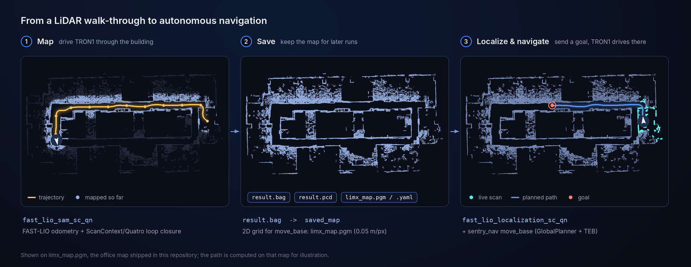
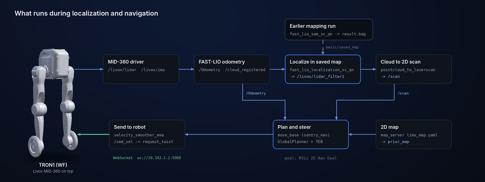

<p align="center">
  
</p>

<p align="center">
  <b>English</b> | <a href="README_cn.md">中文</a>
</p>

<p align="center">
  <a href="LICENSE"></a>
  <a href="THIRD_PARTY_NOTICES.md"></a>
  
  
  
</p>

# Tron1 SS

LiDAR mapping, localization and navigation for TRON1: map a building once with
a Livox MID-360, then localize in that map and send TRON1 to goals with
`move_base`.

> **Scope:** a ROS Noetic catkin workspace. It bundles the Livox driver, a
> FAST-LIO-SAM mapping / localization stack and a `move_base` navigation setup
> that drives TRON1 over its WebSocket interface. It does not include the
> robot's own locomotion controller.

> **Part of the TRON1 open-source ecosystem.** All TRON1 repositories and where to start: [TRON1 open-source ecosystem](https://github.com/limxdynamics/tron1-rl-isaacgym#tron1-open-source-ecosystem).

## Highlights

- **Map once, reuse it.** `fast_lio_sam_sc_qn` builds a 3D map from FAST-LIO
  odometry with ScanContext + Quatro / Nano-GICP loop closure and saves it as
  `result.bag` and `result.pcd`.
- **Localize in the saved map.** `fast_lio_localization_sc_qn` matches live
  scans against that map, so TRON1 starts every run in the same frame.
- **Navigation wired for TRON1.** `move_base` with GlobalPlanner and the TEB
  local planner, a TRON1 footprint, and a 2D scan made from the 3D cloud.
- **Commands go straight to the robot.** `velocity_smoother_ema` turns
  `/cmd_vel` into `request_twist` messages on TRON1's WebSocket API.
- **MID-360 ready.** Driver config, FAST-LIO `mid360.yaml` and a `pcd2pgm`
  tool for turning the point-cloud map into a 2D grid are all included.

## How it works

<p align="center">
  
</p>

<p align="center">
  
</p>

## Quick start

On Ubuntu 20.04 with ROS Noetic and the dependencies from
[section 1](#1-deployment-environment-setup) installed, with the MID-360 on the
`10.192.1.x` network (`livox_ros_driver2/config/MID360_config.json` expects the
host at `10.192.1.3`):

```bash
git clone https://github.com/limxdynamics/tron1-ss
cd tron1-ss
catkin_make_isolated
source devel_isolated/setup.bash

# terminal 1: LiDAR driver
roslaunch livox_ros_driver2 msg_MID360.launch
# terminal 2: build a map
roslaunch fast_lio_sam_sc_qn run.launch lidar:=livox_mid360
```

Then follow [Use your own map](#4-use-your-own-map) and
[Navigation](#5-navigation) to localize in that map and send goals.

## 1. Deployment Environment Setup

**Install ROS Noetic:**  
We recommend building an algorithm development environment based on ROS Noetic on Ubuntu 20.04. ROS provides a suite of tools and libraries—such as core libraries, communication frameworks, and simulation tools (e.g., Gazebo)—which greatly facilitate the development, testing, and deployment of robotic algorithms. These resources offer users a rich and complete development environment.

To install ROS Noetic, please refer to the official documentation:  
👉 [ROS Noetic Installation on Ubuntu](https://wiki.ros.org/noetic/Installation/Ubuntu)  
Make sure to choose the **`ros-noetic-desktop-full`** version.

After installing ROS Noetic, run the following shell commands in a Bash terminal to install the required dependencies:

```bash
sudo apt-get update
sudo apt install ros-noetic-map-server \
                 ros-noetic-octomap-ros \
                 ros-noetic-octomap-msgs \
                 ros-noetic-octomap-server \
                 ros-noetic-dwa-local-planner \
                 ros-noetic-octomap-rviz-plugins\
                 ros-noetic-move-base \
                 ros-noetic-pointcloud-to-laserscan \
                 python3.8 \
                 libeigen3-dev \
                 cmake build-essential libpcl-dev libeigen3-dev libopencv-dev  \
                 python3-pip libboost-all-dev libtbb-dev -y
sudo apt-get install libboost-all-dev libwebsocketpp-dev nlohmann-json3-dev
sudo apt-get install ros-noetic-realsense2-camera ros-noetic-realsense2-camera-dbgsym ros-noetic-realsense2-description

cd ~/ && mkdir tools && cd tools
git clone https://github.com/Livox-SDK/Livox-SDK
cd Livox-SDK/build
cmake .. && make -j6  
sudo make install

git clone https://github.com/Livox-SDK/Livox-SDK2
cd Livox-SDK2 && mkdir build && cd build
cmake .. && make -j6
sudo make install

cd ../../ 
wget -O gtsam.zip [https://github.com/borglab/gtsam/archive/refs/tags/4.1.1.zip](https://github.com/borglab/gtsam/archive/refs/tags/4.1.1.zip)
unzip gtsam.zip
cd gtsam-4.1.1/ && mkdir build && cd build
cmake -DGTSAM_BUILD_WITH_MARCH_NATIVE=OFF -DGTSAM_USE_SYSTEM_EIGEN=ON ..
sudo make install -j6

cd ../../

git clone https://github.com/MIT-SPARK/TEASER-plusplus.git
cd TEASER-plusplus && mkdir build && cd build
cmake .. -DENABLE_DIAGNOSTIC_PRINT=OFF
sudo make install -j6
sudo ldconfig


```

---

## 2. Compilation and Execution


### Step 1: Open a Bash terminal.

### Step 2: Clone the source code repository:

```bash
git clone https://github.com/limxdynamics/tron1-ss
```

### Step 3: Compile the project:

```bash
cd tron1-ss
catkin_make_isolated 
```

---


## 3. Run 

mapping
### Step 1: Mapping
```bash
roslaunch livox_ros_driver2  msg_MID360.launch
roslaunch fast_lio_sam_sc_qn run.launch lidar:=livox_mid360
```

localization and navigation
### Step 2: Localization & Navigation
```bash
roslaunch livox_ros_driver2  msg_MID360.launch
roslaunch fast_lio_localization_sc_qn run.launch lidar:=livox_mid360
```

## 4. Use your own map

Localization and navigation read two map files. The repository ships an
example office map; replace both with your own before running step 2 of
[Run](#3-run).

1. **Save the mapping result.** While `fast_lio_sam_sc_qn` is running, publish
   to `/save_dir` (it also saves when the node shuts down):

   ```bash
   rostopic pub -1 /save_dir std_msgs/String "data: ''"
   ```

   `result.bag` and `result.pcd` are written to the `fast_lio_sam_sc_qn`
   package directory.

2. **Point localization at it.** In
   `fast_lio_localization_sc_qn/config/config.yaml`, set `basic/saved_map` to
   the absolute path of your `result.bag`.

3. **Make the 2D grid for `move_base`.** In
   `sentry_tools/pcd2pgm_package/pcd2pgm/launch/run.launch`, set
   `file_directory` and `file_name` to your `.pcd` (without the extension),
   run it, and save the published `/map`:

   ```bash
   roslaunch pcd2pgm run.launch
   rosrun map_server map_saver -f limx_map
   ```

   Copy `limx_map.pgm` and `limx_map.yaml` into
   `fast_lio_localization_sc_qn/2d_nav_map/`; `run.launch` loads that file and
   publishes it as `prior_map`.

## 5. Navigation

Step 2 of [Run](#3-run) starts localization, the 2D map and the laser scan. It
does not start the planner. With it running, start `move_base` and the bridge
to the robot:

```bash
roslaunch sentry_nav sentry_movebase.launch
```

Before building, set `ACCID` in
`sentry_tools/velocity_smoother_ema/src/velocity_smoother_ema.cpp` to your
robot's serial number. The node connects to `ws://10.192.1.2:5000`, listens
on `/cmd_vel` and forwards each command as `request_twist`. Send goals with
RViz's **2D Nav Goal** (`/move_base_simple/goal`).

| Package | Role |
|---|---|
| `livox_ros_driver2` | MID-360 driver: `/livox/lidar`, `/livox/imu` |
| `fast_lio_sam_sc_qn` | Mapping with loop closure; saves `result.bag` / `result.pcd` |
| `fast_lio_localization_sc_qn` | Localization in the saved map; also starts `map_server` and `pointcloud_to_laserscan` |
| `sentry_nav` | `move_base` with GlobalPlanner + TEB (`w1_param/`) |
| `velocity_smoother_ema` | `/cmd_vel` to TRON1 over WebSocket |
| `pcd2pgm` | Point-cloud map to 2D occupancy grid |

## License

This repository's own deployment & integration code is licensed under [Apache License 2.0](LICENSE). However, the bundled localization & mapping stack (`src/fast-lio-mapping_and_localization-sc-qn/`) is from third parties and is licensed under **CC BY-NC-SA 4.0 (non-commercial)**; it also bundles GPL-2.0 (FAST_LIO) and MIT components.

> ⚠️ **Commercial use of the localization & mapping stack requires a license from the original authors, or replacing those components.** See [THIRD_PARTY_NOTICES.md](THIRD_PARTY_NOTICES.md) for details.
