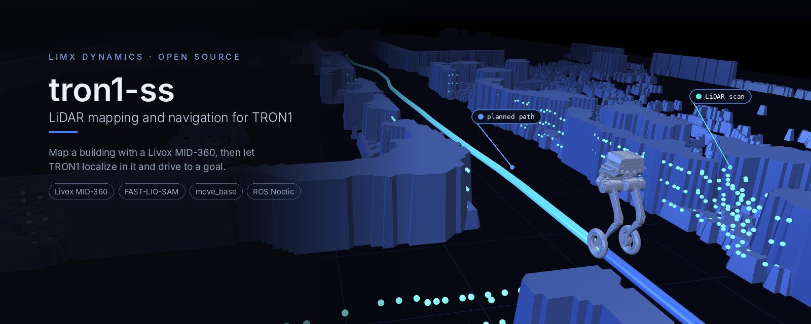
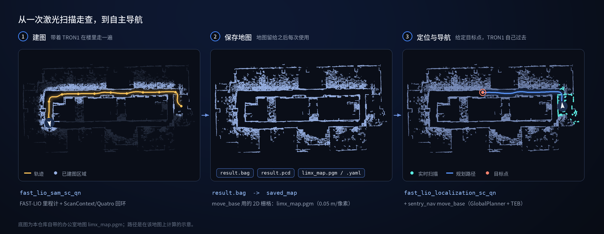
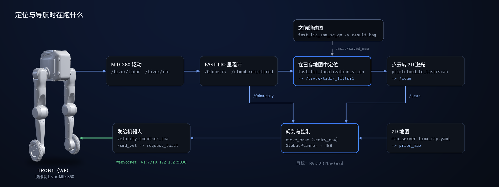

<p align="center">
  
</p>

<p align="center">
  <a href="README.md">English</a> | <b>中文</b>
</p>

<p align="center">
  <a href="LICENSE"></a>
  <a href="THIRD_PARTY_NOTICES.md"></a>
  
  
  
</p>

# Tron1 SS

TRON1 的激光建图、定位与导航：用 Livox MID-360 把楼层建一次图，之后在这张图里定位，
再用 `move_base` 让 TRON1 自己走到目标点。

> **范围：** 一个 ROS Noetic catkin 工作空间，包含 Livox 驱动、FAST-LIO-SAM
> 建图/定位栈，以及通过 WebSocket 接口驱动 TRON1 的 `move_base` 导航配置。
> 不包含机器人自身的运动控制器。

> **TRON1 开源生态的一部分。** TRON1 全部开源仓库和上手路线：[TRON1 开源生态](https://github.com/limxdynamics/tron1-rl-isaacgym/blob/master/README_cn.md#tron1-开源生态)。

## 亮点

- **建一次图，反复使用。** `fast_lio_sam_sc_qn` 基于 FAST-LIO 里程计，配合
  ScanContext + Quatro / Nano-GICP 回环构建 3D 地图，并保存为 `result.bag` 和 `result.pcd`。
- **在已存地图中定位。** `fast_lio_localization_sc_qn` 把实时点云和这张地图匹配，
  每次启动 TRON1 都在同一个坐标系里。
- **为 TRON1 配好的导航。** `move_base` 使用 GlobalPlanner 与 TEB 局部规划器、
  TRON1 的轮廓尺寸，以及由 3D 点云转出的 2D 激光。
- **指令直接发给机器人。** `velocity_smoother_ema` 把 `/cmd_vel` 转成 TRON1
  WebSocket 接口上的 `request_twist` 消息。
- **适配 MID-360。** 自带驱动配置、FAST-LIO 的 `mid360.yaml`，以及把点云地图转成
  2D 栅格的 `pcd2pgm` 工具。

## 工作原理

<p align="center">
  
</p>

<p align="center">
  
</p>

## 快速开始

在已安装 ROS Noetic 和 [第 1 节](#1-部署环境配置) 依赖的 Ubuntu 20.04 上，MID-360
接在 `10.192.1.x` 网段（`livox_ros_driver2/config/MID360_config.json` 中主机地址为
`10.192.1.3`）：

```bash
git clone https://github.com/limxdynamics/tron1-ss
cd tron1-ss
catkin_make_isolated
source devel_isolated/setup.bash

# 终端 1：激光雷达驱动
roslaunch livox_ros_driver2 msg_MID360.launch
# 终端 2：建图
roslaunch fast_lio_sam_sc_qn run.launch lidar:=livox_mid360
```

之后按 [使用自己的地图](#4-使用自己的地图) 和 [导航](#5-导航) 在地图中定位并发送目标点。

## 1. 部署环境配置

- 安装ROS Noetic：我们推荐在Ubuntu 20.04操作系统上建立基于ROS Noetic的算法开发环境。ROS提供了一系列工具和库，如核心库、通信库和仿真工具（如Gazebo），极大地便利了机器人算法的开发、测试和部署。这些资源为用户提供了一个丰富而完整的算法开发环境。ROS Noetic 安装请参考文档：https://wiki.ros.org/noetic/Installation/Ubuntu ，选择“ros-noetic-desktop-full”进行安装。ROS Noetic 安装完成后，Bash终端输入以下Shell命令，安装开发环境所依赖的库：

```bash
sudo apt-get update
sudo apt install ros-noetic-map-server \
                 ros-noetic-octomap-ros \
                 ros-noetic-octomap-msgs \
                 ros-noetic-octomap-server \
                 ros-noetic-dwa-local-planner \
                 ros-noetic-octomap-rviz-plugins\
                 ros-noetic-move-base \
                 ros-noetic-pointcloud-to-laserscan \
                 python3.8 \
                 libeigen3-dev \
                 cmake build-essential libpcl-dev libeigen3-dev libopencv-dev  \
                 python3-pip libboost-all-dev libtbb-dev -y
sudo apt-get install libboost-all-dev libwebsocketpp-dev nlohmann-json3-dev
sudo apt-get install ros-noetic-realsense2-camera ros-noetic-realsense2-camera-dbgsym ros-noetic-realsense2-description

cd ~/ && mkdir tools && cd tools
git clone https://github.com/Livox-SDK/Livox-SDK
cd Livox-SDK/build
cmake .. && make   
sudo make install

git clone https://github.com/Livox-SDK/Livox-SDK2
cd Livox-SDK2 && mkdir build && cd build
cmake .. && make -j6
sudo make install

cd ../../ 
wget -O gtsam.zip [https://github.com/borglab/gtsam/archive/refs/tags/4.1.1.zip](https://github.com/borglab/gtsam/archive/refs/tags/4.1.1.zip)
unzip gtsam.zip
cd gtsam-4.1.1/ && mkdir build && cd build
cmake -DGTSAM_BUILD_WITH_MARCH_NATIVE=OFF -DGTSAM_USE_SYSTEM_EIGEN=ON ..
sudo make install -j6

cd ../../

git clone https://github.com/MIT-SPARK/TEASER-plusplus.git
cd TEASER-plusplus && mkdir build && cd build
cmake .. -DENABLE_DIAGNOSTIC_PRINT=OFF
sudo make install -j6
sudo ldconfig


```

   

## 2. 编译运行

- 打开一个Bash终端。

- 下载源代码：
    ```Bash
    git clone https://github.com/limxdynamics/tron1-ss
    ```
    
- 编译工程：
    ```Bash
    cd tron1-ss
    catkin_make_isolated 
    ```
    
## 3. 运行 

建图
- 打开两个Bash终端。
    ```Bash
    roslaunch livox_ros_driver2  msg_MID360.launch
    roslaunch fast_lio_sam_sc_qn run.launch lidar:=livox_mid360
    ```


定位和导航
- 打开两个Bash终端。
    ```Bash
    roslaunch livox_ros_driver2  msg_MID360.launch
    roslaunch fast_lio_localization_sc_qn run.launch lidar:=livox_mid360
    ```

## 4. 使用自己的地图

定位和导航会读取两份地图文件。仓库自带一张示例办公室地图；运行 [运行](#3-运行)
中的定位和导航之前，请把两份都换成你自己的。

1. **保存建图结果。** `fast_lio_sam_sc_qn` 运行时向 `/save_dir` 发布一条消息
   （节点退出时也会保存）：

   ```bash
   rostopic pub -1 /save_dir std_msgs/String "data: ''"
   ```

   `result.bag` 和 `result.pcd` 会写到 `fast_lio_sam_sc_qn` 功能包目录下。

2. **让定位使用它。** 在 `fast_lio_localization_sc_qn/config/config.yaml` 中，
   把 `basic/saved_map` 设为你的 `result.bag` 的绝对路径。

3. **生成 `move_base` 用的 2D 栅格。** 在
   `sentry_tools/pcd2pgm_package/pcd2pgm/launch/run.launch` 中把 `file_directory`
   和 `file_name` 指向你的 `.pcd`（不含扩展名），运行后保存发布出来的 `/map`：

   ```bash
   roslaunch pcd2pgm run.launch
   rosrun map_server map_saver -f limx_map
   ```

   把 `limx_map.pgm` 和 `limx_map.yaml` 复制到
   `fast_lio_localization_sc_qn/2d_nav_map/`；`run.launch` 会加载它并发布为 `prior_map`。

## 5. 导航

[运行](#3-运行) 中的定位和导航命令会启动定位、2D 地图和激光转换，但不会启动规划器。
在它运行时，再启动 `move_base` 和到机器人的桥接：

```bash
roslaunch sentry_nav sentry_movebase.launch
```

编译前，把 `sentry_tools/velocity_smoother_ema/src/velocity_smoother_ema.cpp` 中的
`ACCID` 改成你的机器人序列号。该节点连接 `ws://10.192.1.2:5000`，订阅 `/cmd_vel`，
把每条指令以 `request_twist` 转发。用 RViz 的 **2D Nav Goal**（`/move_base_simple/goal`）发送目标点。

| 功能包 | 作用 |
|---|---|
| `livox_ros_driver2` | MID-360 驱动：`/livox/lidar`、`/livox/imu` |
| `fast_lio_sam_sc_qn` | 带回环的建图；保存 `result.bag` / `result.pcd` |
| `fast_lio_localization_sc_qn` | 在已存地图中定位；同时启动 `map_server` 和 `pointcloud_to_laserscan` |
| `sentry_nav` | `move_base`，GlobalPlanner + TEB（`w1_param/`） |
| `velocity_smoother_ema` | 通过 WebSocket 把 `/cmd_vel` 发给 TRON1 |
| `pcd2pgm` | 点云地图转 2D 占据栅格 |

## 许可证

本仓库自身的部署与集成代码采用 [Apache License 2.0](LICENSE)。但捆绑的定位/建图栈（`src/fast-lio-mapping_and_localization-sc-qn/`）来自第三方，许可为 **CC BY-NC-SA 4.0（禁止商用）**，其中还包含 GPL-2.0（FAST_LIO）与 MIT 组件。

> ⚠️ **商用使用该定位/建图栈需联系原作者获取授权，或替换这些组件。** 详见 [THIRD_PARTY_NOTICES.md](THIRD_PARTY_NOTICES.md)。
